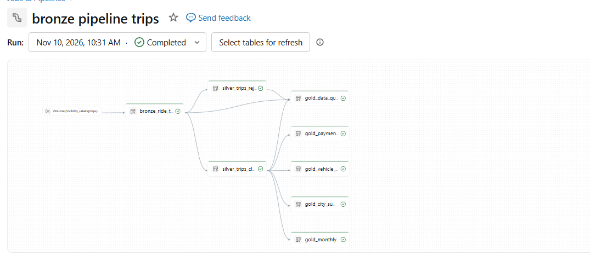
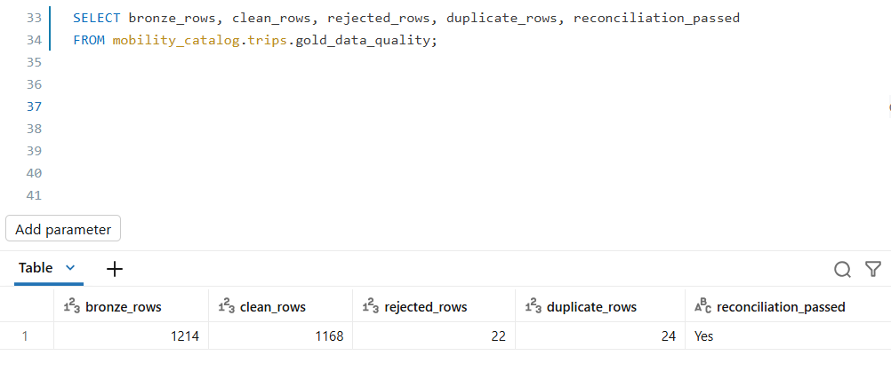
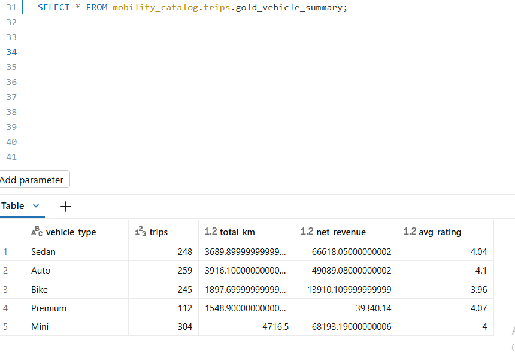
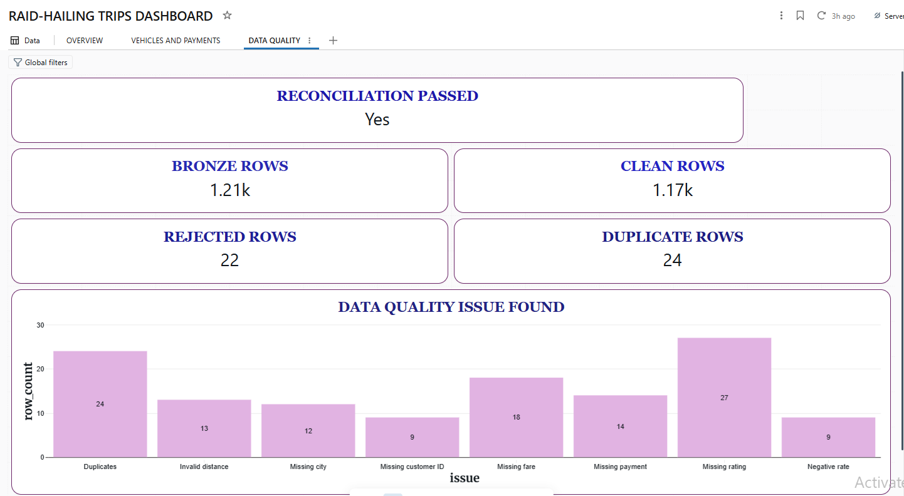

# Ride-Hailing Trip Analytics

A Databricks Medallion pipeline (Bronze, Silver, Gold) built with Lakeflow Spark Declarative Pipelines in SQL, plus a 3-page AI/BI dashboard. It turns a raw cab trips CSV (1,214 rows) into trusted summary tables and proves that no row was lost.

**Tools:** Databricks, Unity Catalog, Lakeflow Spark Declarative Pipelines (SQL), Databricks AI/BI

## Business problem

A cab-booking company exports its completed trips to a CSV file every month. The file has extra spaces, inconsistent capital letters, blank values, duplicate trips, and impossible distances and rates. Reports were made by hand in Excel, which is slow and error-prone. Managers need reliable numbers for trips, revenue, cities, vehicle types and payment methods.

## Architecture

Source CSV (Unity Catalog Volume) -> Bronze -> Silver (clean + rejected) -> Gold -> AI/BI Dashboard

| Layer | Table | Purpose |
|---|---|---|
| Bronze | `bronze_ride_trips` | Raw rows plus source file name and load time |
| Silver | `silver_trips_clean` | Deduplicated, standardised trips |
| Silver | `silver_trips_rejected` | Trips with zero or negative distance, or negative rate, with a reject reason |
| Gold | `gold_monthly_trips` | Trips, distance, net revenue, driver payout and platform earnings per month |
| Gold | `gold_city_summary` | Trips, net revenue and average fare per region and city |
| Gold | `gold_vehicle_summary` | Trips, distance, net revenue and average rating per vehicle type |
| Gold | `gold_payment_summary` | Trips, net revenue and pending amount per payment method |
| Gold | `gold_data_quality` | Problem counts and the reconciliation check |

## Pipeline

Bronze keeps the raw data, Silver cleans it and quarantines bad rows, and Gold builds the summary tables. The full code is in `ride_trips_pipeline.sql`.

## Data cleaning rules

| Problem | Rows | Rule | Why |
|---|---|---|---|
| Duplicate trips | 24 | `SELECT DISTINCT` | `trip_id` must be unique |
| Extra spaces, mixed case (city, vehicle type, booking channel) | many | `INITCAP(TRIM(col))` | Group names consistently |
| Blank city | 12 | `COALESCE` to 'Unknown' | Keep the trip and show the gap |
| Blank payment method | 14 | `COALESCE` to 'Unknown' (no INITCAP, so "UPI" stays "UPI") | Keep the trip and show the gap |
| Blank fare | 18 | distance x rate per km | The formula defines the fare |
| Blank rating | 27 | Left as NULL | AVG skips NULLs, and 0 would lower the averages |
| Blank customer ID | 9 | Left as NULL | The trip and revenue are still valid |
| Zero or negative distance | 13 | Moved to the rejected table with a reason | Impossible value |
| Negative rate per km | 9 | Moved to the rejected table with a reason | Impossible value |

## Data quality and reconciliation

**1,214 Bronze rows = 1,168 clean + 22 rejected + 24 duplicates removed.** The `gold_data_quality` table returns `reconciliation_passed = Yes`.

## Gold table example

## Dashboard

Built in Databricks AI/BI on the Gold tables only.

### Page 1: Overview

1,168 trips, about 2.37 lakh net revenue, 15,769 km and about 52.6 thousand platform earnings, with net revenue by month and by city.

### Page 2: Vehicles and Payments

Trips, net revenue and average rating by vehicle type, trips by payment method and the pending amount.

### Page 3: Data Quality

Bronze, clean, rejected and duplicate row counts, the reconciliation check and a bar chart of the issues found.

## Key results

- Mini earns the most net revenue, and Auto has the best average rating (4.10).
- UPI is the most used payment method.
- Bengaluru has the highest net revenue among cities.
- Ratings are averaged only across trips that have one, never summed.

## How to run

1. Create catalog `mobility_catalog`, schema `trips` and volume `raw_files`.
2. Upload `ride_trips_raw.csv` to `/Volumes/mobility_catalog/trips/raw_files/`.
3. Create an ETL pipeline with default catalog `mobility_catalog` and schema `trips`, and add `ride_trips_pipeline.sql`.
4. Click **Run pipeline**, then refresh the dashboard.

## What I learned

- Keep the raw layer so cleaning mistakes can be fixed and re-run.
- Not every blank needs filling: a blank rating stays NULL so averages are not distorted.
- Some columns must skip text cleaning, because INITCAP would turn "UPI" into "Upi".
- Reconcile row counts to prove that no row was lost.

## Repository files

- `ride_trips_pipeline.sql`: full pipeline code
- `ride_trips_raw.csv`: synthetic source data
- Screenshots: pipeline graph, data quality result, Gold table and the three dashboard pages
